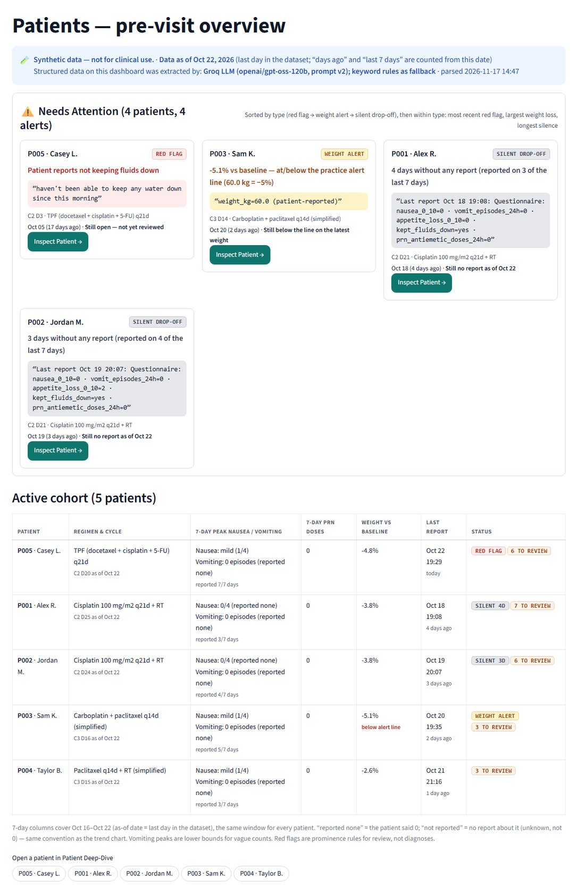
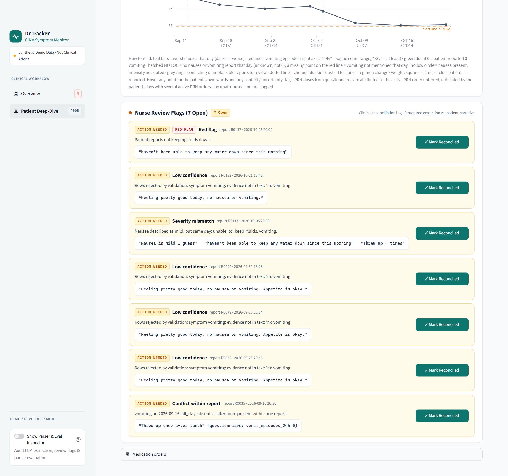
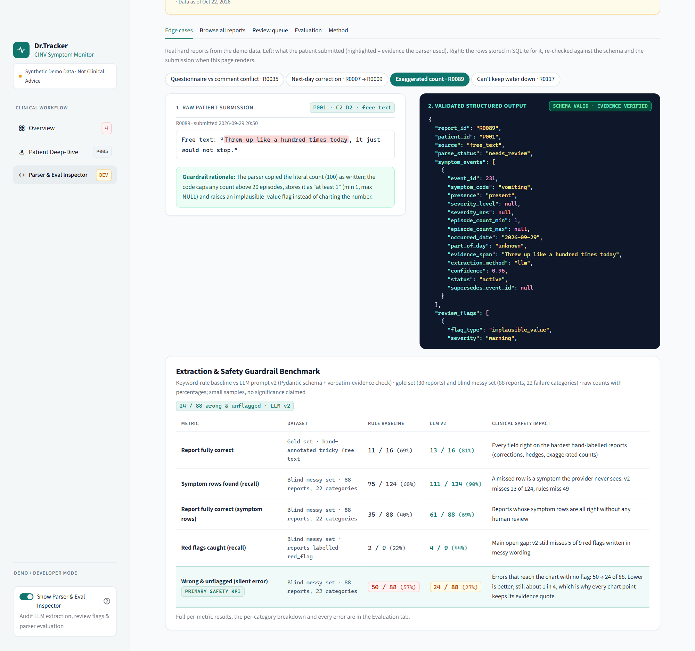

# CINV patient-reported data: store, manage and chart

Track B prototype for the Dr.Tracker data-intelligence assessment.

> **Synthetic data only — not for clinical use.** All patients are fictional. Nothing here is a diagnosis, a
> clinical grade or clinical advice.

---

## 1. Project goal

### The problem

Patients on chemotherapy report nausea and vomiting (CINV) between visits, in their own words ("threw up a few
times after lunch") or through a short questionnaire. Providers do not have time to read every message before a
visit.

### The goal

Turn each report into **structured data that can be traced back to the patient's own words**, and show it so a
provider can see **in about 30 seconds who needs attention**, how this cycle compares with the last one, and
whether a medication change helped.

---

## 2. Data design

### Core principles

- **The patient's words are never changed.** `raw_reports` is immutable (database triggers block edits; only
  `parse_status` can change). Parsers can be re-run and audited at any time.
- **Event (long) model.** One report becomes many symptom, medication and weight events. A new symptom adds rows,
  not columns.
- **Unknown stays empty (NULL).** "Not sure if it's nausea" → `presence = 'uncertain'`, severity NULL. "Reported 0"
  and "not reported" stay different all the way to the chart.
- **Counts are ranges.** "Twice" = 2–2, "a few" = 2–4, "kept throwing up" = at least 1, upper bound NULL.
- **Conflicts are kept and flagged, not silently resolved.** Both versions are stored with a review flag. A
  correction marks the old row `superseded` (never deleted) and links the new one to it.
- **Every row is traceable.** Each structured row stores an `evidence_span` that must appear **verbatim** in the
  report, or the row is dropped and flagged.
- **One time anchor.** `chemo_administrations` gives every symptom a cycle day and a phase (acute = day 1,
  delayed = days 2–5).

### Main tables (`schema.sql`)

| Table | Purpose |
|---|---|
| `patients`, `chemo_administrations` | Who, and when each infusion happened (the time anchor) |
| `medications`, `medication_orders` | Drug dictionary; a change closes one order and opens a new one, so before/after stays comparable |
| `raw_reports` | Immutable patient submissions (free text or questionnaire) |
| `extraction_runs` | Which parser and prompt version produced each set of rows |
| `symptom_events`, `medication_intake_events`, `weight_measurements` | The structured events, each with its `evidence_span` |
| `review_flags`, `flag_events` | Open issues for a nurse (conflict, red flag, low confidence, …) and their history |
| Views `v_daily_symptom_summary`, `v_daily_medication_intake`, `v_weight_trend` | One documented chart rule applied everywhere (active events only; conflicting counts → the larger value, day marked) |

---

## 3. Streamlit dashboard

Two clinical pages, plus one developer page behind a sidebar toggle (off by default).

### Overview — "Who needs attention today?"

Red flags, weight below the alert line, and silent drop-off (≥ 3 days without a report) at the top; a cohort
table below. Every page uses one **as-of date**, so a patient who stopped reporting shows gaps, not an older,
healthier-looking week.



### Patient Deep-Dive — "What do I need to know before I walk in?"

- A 4-card pre-visit header.
- Timeline vs. Cycle-over-Cycle chart: nausea (0–4) and vomiting counts on one chart, PRN doses and weight below on
  the same date axis.
- A regimen-change marker with an observational before/after panel (no causal claim).
- **Nurse Review Flags**: one card per open flag, with the patient's words and a "Mark Reconciled" button.
- Missing ≠ zero: hatched "NO LOG" means no report; a green dot at 0 means the patient reported no vomiting.
  Tooltips show the verbatim `evidence_span`.



### Developer mode — Parser & Eval Inspector

For the team, not the provider: edge cases with their structured output and a "Schema valid · Evidence verified"
badge (shown only when the stored rows re-load into the Pydantic models and every evidence span is found), all
reports, the review queue, evaluation results and the method.



---

## 4. AI usage and human-in-the-loop decisions

### Schema design

Claude drafted the schema; the author decided the open design questions (symptom scope, conflict rule,
medication-intake and chemo-anchor tables, keeping raw 0–10 scores) and reviewed edge cases.

### Parser

- **LLM** (Groq `openai/gpt-oss-120b`, JSON mode, temperature 0, prompt v2) **understands the language**: which
  symptoms, present / absent / uncertain, counts, severity words, time words, medication *mentions*, "is this a
  correction?".
- **Code does everything checkable**: dates (the LLM returns only a relative day offset), mapping drug mentions to
  the dictionary, the verbatim evidence check, the plausibility guard, and **every review flag**.
- **Deterministic flag layer** (`cinv/flag_layer.py`) runs after the LLM, prompt unchanged. It never edits the LLM's
  rows, it only adds flags:
  - `low_confidence`: presence `uncertain`; hedging (maybe, idk, i think, not sure, ??, "like N"); empty,
    emoji-only or non-English text; second-hand accounts (says, told me, husband / mom …); uncertain dates
    (day N, the other day, "or was that yesterday").
  - `parser_disagreement`: the keyword-rule parser and the LLM disagree on symptoms, presence or counts
    (any difference, including a symptom found only by the LLM).
  - **The rules are frozen as the final version**; any change needs a fresh blind set to measure it.
  - `distress` (scared, can't do this, give up, 😭 …): urgent, shown as a red flag.
  - `other_symptom`: complaints outside the schema (fever, diarrhea, constipation, hair loss, fatigue, pain);
    fever also raises a `red_flag`.
  - `prompt_injection`: "ignore previous instructions", "SYSTEM:", "admin mode", JSON-like text.
- Questionnaires are parsed fully deterministically. A keyword-rule parser is both the baseline and the per-report
  fallback.

### Synthetic dataset

- `generate_data.py` (written with Claude, fixed seed) builds **5 fictional head-and-neck cancer patients × 6
  weeks**: 12 infusions, 10 medication orders, **184 reports** (129 free text, 55 questionnaires).
- A hidden "truth" curve per patient and day follows the commonly described CINV pattern (peak around days 2–3
  after infusion, scaled by the regimen's emetogenic risk). Routine reports are rendered from that truth by
  templates.
- **15 hand-written tricky cases (18 reports)** cover vague counts, conflicts, corrections, a vomited-up dose,
  questionnaire vs. comment disagreement, and more.

### Gold set (30 reports)

- 12 routine reports: labels come straight from the generator.
- 18 tricky reports: **AI drafted the labels, the author reviewed each one**: **16 agreed, 2 revised**
  (`data/gold_review.csv`). Both revisions were questionnaire PRN drugs labelled as patient-stated when they were
  inferred, which led to an explicit *inferred vs. stated* field.

### Blind messy set (88 reports)

- 22 failure categories × 4 (typos, slang, hedging, second-hand accounts, emoji, non-English, distress, …).
- Text written by a **different model** (Groq `qwen/qwen3.8-27b`) so the parser's model never writes its own
  test set; label drafts by Claude.
- **The author reviewed all 88 labels and revised 9 before any parser ran** (`data/blind_review.csv`). The prompt
  was not changed after seeing the results.
- **It is now a development set, not a blind test.** The rule baseline and prompt v2 were scored blind, but the
  deterministic flag layer was written *after* these 88 results had been seen, so its numbers below are in-sample.
  A fresh blind set is needed to measure it.

### Blind set 2 (50 reports, pending author review)

- Built to evaluate the frozen flag layer (tag `flag-layer-final`): **35 edge cases** covering all 22 categories
  (13 extra on the most safety-relevant ones) and **15 routine reports** to measure false alarms.
- Text by Groq `qwen/qwen3.8-27b` with new personas and scenarios (`generate_blind_set2.py`); every report is
  checked against blind set 1 for similarity (difflib ratio ≤ 0.6, highest 0.52).
- Labels drafted by Claude in the set-1 format (`data/blind2_review.csv`); any `uncertain` row expects
  `low_confidence`; distress counts as `red_flag`; the new `other_symptom` / `prompt_injection` types are used
  where they apply. **No parser has been run on these 50 reports**; that happens only after the author's review.

### Evaluation results (rules vs. LLM prompt v2)

Full tables and every error: [`eval/results.md`](eval/results.md). Raw counts, small samples, no significance
claimed.

**Gold set, free text (n = 23)**

| | Rule baseline | LLM v2 |
|---|---|---|
| Presence · count · severity | 38/39 · 14/15 · 17/18 | 39/39 · 15/15 · 18/18 |
| Report fully correct — tricky · routine | 11/16 · 7/7 | 13/16 · 5/7 |
| Review-flag recall | 4/5 | 5/5 |
| **Wrong & unflagged** | **3/23** | **3/23** |

Questionnaires (n = 7): 100% on every field for both (deterministic).

Flag rate and false alarms on the gold set (all 30 reports; false alarm = a fully correct report that is flagged
anyway):

| | LLM v2 | LLM v2 + flag layer |
|---|---|---|
| Flag rate — routine · tricky | 1/12 · 6/18 | 1/12 · 11/18 |
| False-alarm rate — routine · tricky | 0/10 · 5/15 | 0/10 · 10/15 |

The 3 wrong & unflagged gold reports (part of day / date slips with no hedging cue) are not caught by the layer.

**Nurse workload: flag rate on the whole main dataset (184 reports, unlabelled)**

| | Rule baseline | LLM v2 | LLM v2 + flag layer |
|---|---|---|---|
| Reports with any flag | 6/184 | 27/184 | 32/184 |
| … warning or urgent (report set to needs_review) | 3/184 | 25/184 | 30/184 |

**Messy set (n = 88; blind for rules and v2, development set for the flag layer)**

| | Rule baseline | LLM v2 | LLM v2 + flag layer (in-sample) |
|---|---|---|---|
| Symptom rows recall · precision | 75/124 · 75/78 | 111/124 · 111/114 | same as v2 (flags only) |
| Report fully correct | 35/88 | 61/88 | 61/88 |
| **Wrong & unflagged** · wrong & flagged | **50/88** · 3/88 | **24/88** · 3/88 | **3/88** · 24/88 |
| Review-flag recall · red-flag recall | 4/61 · 2/9 | 11/61 · 4/9 | 42/61 · 9/9 |
| **Flag rate** | 5/88 | 12/88 | **68/88** |
| **False-alarm rate** (correct reports flagged) | 2/35 | 9/61 | **44/61** |
| … of which no flag was labelled for the report | 0/16 | 0/25 | 12/25 |

**Why "wrong & unflagged" is the main safety metric:** a flagged error goes to a nurse with the patient's words
next to it; an unflagged error looks exactly like a correct value on the chart. Without the layer, 24 of the LLM's
27 wrong reports were unflagged. The flag layer brings that to 3/88, **but the price is review load on messy
text**: 77% of messy reports get a flag, and 44 of the 61 correct ones are flagged too (32 of those were reports
whose reviewed labels already asked for a flag, e.g. hedged counts; 12 were not). On the main dataset, which is
mostly routine, the layer adds only 5 reports to the queue (27 → 32 of 184). These numbers are in-sample.

**Experiment, rejected: a narrower `parser_disagreement`** (only rules-only symptoms, present vs absent, or
non-overlapping counts; LLM-only symptoms ignored).

| | Narrow (rejected) | Final |
|---|---|---|
| Messy set: wrong & unflagged | 7/88 | **3/88** |
| Messy set: flag rate · false alarms | 61/88 · 41/61 | 68/88 · 44/61 |
| Gold tricky: flag rate · false alarms | 10/18 · 9/15 | 11/18 · 10/15 |
| Main dataset flag rate | 31/184 | 32/184 |

It let 4 more errors reach the chart unflagged (BL04, BL30, BL46, BL48) to save 3 false alarms, with almost the
same nurse workload. In a clinical setting safety comes first, so the broader rule is the final version, frozen
(git tag `flag-layer-final`).

### Key judgments made by the author

- **Misspelled drug names are not auto-matched.** "zofram", "compazene" → flagged `unmapped_medication`, never
  fuzzy-matched to a drug (decided on BL20, applied to BL19 / BL63 / BL64).
- **Implied symptoms are `uncertain`, not `present`.** "zofram helped a bit" → nausea uncertain; "can't keep food
  down" → vomiting uncertain, no count.
- **Self-contradicting reports get `intra_report_conflict`**, not a severity mismatch.
- **Out-of-schema complaints must not disappear silently** (hair loss, fatigue) → flagged for review.
- **A duplicate is flagged only when the earlier report exists**; otherwise the flag is dropped.
- **Distress messages** ("I can't do this anymore") are out of the parser's scope but must go to human review at
  high priority, never vanish because they contain no symptom.

---

## 5. Next steps

### Implementation

**Prompt**
- Ask for the **full contiguous evidence phrase**, so correct rows are not dropped by the verbatim check.
- Record **clock times the patient states** ("took it at 8", "around 2pm"), marked exact or approximate.

**System**
- **Measure the frozen flag layer on a fresh blind set**; its current numbers are in-sample.
- **Hybrid routing**: rules for routine reports they cover with high confidence, LLM for the rest; the router's
  acceptance rule is judged by wrong & unflagged (and flag rate) on a blind set.
- **Similarity check against a labelled example library**: compare each evidence span with reviewed examples (local
  embeddings); flag disagreements, never override.
- **PRN questionnaire by drug name** when a patient has several active PRN orders (today the dose is attributed to
  the single active PRN order and shown as *inferred*).

### Project implications

**Track C (EHR delivery)**
- Export active events as **HL7 FHIR R4 `Observation` / `QuestionnaireResponse`** resources.
- Keep `evidence_span` as provenance so the EHR can show the patient's words.
- Generate a **pre-visit summary** from the same views the dashboard uses.

**Other specialties (e.g. dermatology, gastroenterology)**
- One **core engine** (extraction loop, verbatim evidence check, schema retry, cache, evaluation harness).
- One **config pack per specialty**: symptom vocabulary, units and thresholds, red-flag rules.
- Generalize the time anchor from chemotherapy to **care-plan milestones** (infusion, taper step, lab check-in), so
  the same window queries keep working.

**Production readiness**
- SQLite → **Postgres**; **access control and audit logs**.
- Before any real PHI (no compliance claim made here): an agreement with the model provider or a self-hosted model,
  data minimization and de-identification before model calls, encryption at rest and in transit, a retention
  policy, and a privacy and security review.
- **Version models and prompts** (already recorded per run in `extraction_runs`).
- **Run the evaluation in CI**; block changes that raise wrong & unflagged.
- **Monitor after launch**: flag rate and the outcomes of human review.
- **Re-evaluate regularly** on a fresh blind set.

---

## 6. How to run it

Requires **Python 3.11+** (built on 3.13). **No API key needed**: the dashboard reads the committed, pre-built
`data/cinv_demo.db`, and the LLM output is cached in `data/llm_cache.json`. The first run creates `.venv`, installs
dependencies and opens http://localhost:8501.

**Windows (PowerShell)**

```powershell
git clone https://github.com/wangyiran-233/dr-tracker-track-b.git; cd dr-tracker-track-b
powershell -ExecutionPolicy Bypass -File .\run_demo.ps1
```

**macOS / Linux (Terminal)**

```bash
git clone https://github.com/wangyiran-233/dr-tracker-track-b.git && cd dr-tracker-track-b
bash run_demo.sh        # on macOS, install Python first if needed, e.g. `brew install python@3.13`
```

**Tests and full rebuild** (inside `.venv`, offline)

```bash
python -m pip install -r requirements-dev.txt && python -m pytest
python generate_data.py && python init_db.py --db data/cinv_demo.db
python parse_reports.py --text-parser llm --offline --strict --db data/cinv_demo.db   # from data/llm_cache.json
python evaluate.py --offline                                                          # writes eval/results.md
```

More detail: [docs/design_decisions.md](docs/design_decisions.md).
